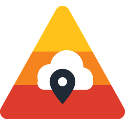

# KNMI Waarschuwingen voor Home Assistant (onofficieel)

[](https://www.home-assistant.io/blog/2026/11/04/release-202611/)
[](https://github.com/epcodijk/ha-knmi-waarschuwingen/actions/workflows/validate.yml)
[](https://github.com/epcodijk/ha-knmi-waarschuwingen/actions/workflows/tests.yml)

> [!WARNING]
> **Dit is een onofficiële community-integratie. Zij is niet gemaakt, goedgekeurd, ondersteund of gecontroleerd door het KNMI.**
> Gebruik is volledig op eigen risico en zonder enige garantie. Vertrouw voor je veiligheid nooit alleen op deze integratie:
> de officiële waarschuwingen staan op [knmi.nl](https://www.knmi.nl/nederland-nu/weer/waarschuwingen), in de KNMI-app en via NL-Alert.
> Zie [Disclaimer](#disclaimer).
>
> *This is an unofficial community integration, not made, endorsed or supported by KNMI. Use at your own risk, without any warranty. See [Disclaimer](#disclaimer).*

KNMI-weerwaarschuwingen (code geel, oranje, rood) in Home Assistant, **voor jouw exacte locatie**, op basis van de open data van het KNMI.

Sinds 2 november 2026 waarschuwt het KNMI niet meer per provincie, maar voor flexibele gebieden. Deze integratie haalt de nieuwe dataset
[KNMI public weather warnings](https://dataplatform.knmi.nl/dataset/knmi-public-weather-warnings-1-0) op van het KNMI Data Platform en controleert
of jouw locatie binnen het waarschuwingsgebied (polygoon) valt. Geen provincie-instellingen, geen scraping, geen tussenpartij.

*English: Home Assistant integration for official Dutch KNMI weather warnings, matched against the exact warning areas for your location.*

## Functies

- Waarschuwingen per locatie op basis van de KNMI-polygonen (meerdere locaties mogelijk)
- Huidige kleurcode én hoogste kleurcode in de komende 48 uur
- Aparte melding voor *mogelijk gevaarlijk weer* (tot een week vooruit)
- Teksten in het Nederlands of Engels: kop, beschrijving, impact en handelingsadvies
- Statussen wisselen precies op het begin- en eindtijdstip, niet pas bij de volgende poll
- Event `knmi_waarschuwingen_new_warning` bij een nieuwe of gewijzigde waarschuwing, handig voor notificaties
- Gebruikt je eigen gratis KNMI Open Data API-key
- Attribuut `effective` blijft beschikbaar, zodat templates van de MeteoAlarm-integratie blijven werken

## Installatie

### Marketplace (aanbevolen, Home Assistant 2026.11 en nieuwer)

1. **Instellingen → Marketplace → Add from link**
2. Vul `https://github.com/epcodijk/ha-knmi-waarschuwingen` in
3. Installeer **KNMI Waarschuwingen** en herstart Home Assistant via de melding onder **Instellingen → Systeem → Reparaties**
4. Voeg de integratie toe onder **Instellingen → Apparaten & diensten**

Nieuwe versies verschijnen daarna vanzelf onder **Instellingen → Updates**.
Voor *Add from link* is een GitHub-koppeling nodig; de Marketplace leest alleen openbare repositories.

### HACS (Home Assistant 2026.10 en ouder)

HACS → menu (⋮) → **Custom repositories** → deze repository-URL, type **Integration**.

### Handmatig

Kopieer `custom_components/knmi_waarschuwingen` naar `config/custom_components/` en herstart Home Assistant. Je krijgt dan geen updatemeldingen.

## Instellen

**Instellingen → Apparaten & diensten → Integratie toevoegen → KNMI Waarschuwingen**

| Veld | Uitleg |
|---|---|
| Naam | Bijv. `Thuis` of `Zwolle`. Wordt onderdeel van de entity-namen. |
| Breedte-/lengtegraad | Standaard de locatie van je Home Assistant |
| API-key | Je eigen Open Data API-key, zie hieronder |

Voeg de integratie nog een keer toe voor extra locaties (werk, ouders, vakantiehuis).

Via **Configureren** stel je het ophaalinterval (standaard 5 minuten) en de taal van de teksten in.

### API-key

Je hebt een **gratis eigen key** nodig voor de *Open Data API*:

1. Maak een account aan op het [KNMI Developer Portal](https://developer.dataplatform.knmi.nl/).
2. Vraag in de API Catalog een key aan voor de **Open Data API**. Een key voor de EDR- of WMS-API werkt hier niet.
3. Je ontvangt de key per mail. Vul hem in bij het toevoegen van de integratie.

Een geregistreerde key heeft een quotum van 1000 verzoeken per uur. Bij elke poll doet de integratie één verzoek, en bij een nieuwe snapshot komt daar één bij. Met het standaardinterval van 5 minuten zit je op zo'n 12 tot 15 verzoeken per uur. Weigert het KNMI de key, dan vraagt Home Assistant je om een nieuwe in te vullen.

## Entities

Voorbeeld voor een locatie met de naam `Zwolle` (entity-id's hangen af van de taal van je installatie):

| Entity | Type | Betekenis |
|---|---|---|
| `sensor.knmi_zwolle_kleurcode` | enum | Hoogste kleurcode **die nu geldt**: `green`, `yellow`, `orange` of `red` |
| `sensor.knmi_zwolle_hoogste_kleurcode_48_uur` | enum | Hoogste kleurcode van alle huidige en komende waarschuwingen |
| `sensor.knmi_zwolle_volgende_waarschuwing` | timestamp | Begintijd van de eerstvolgende waarschuwing |
| `binary_sensor.knmi_zwolle_waarschuwing_actief` | safety | Aan zolang er nu een waarschuwing geldt |
| `binary_sensor.knmi_zwolle_waarschuwing_verwacht` | safety | Aan als er een waarschuwing aankomt |
| `binary_sensor.knmi_zwolle_mogelijk_gevaarlijk_weer` | safety | Aan bij *mogelijk gevaarlijk weer* (nog geen code) |
| `sensor.knmi_zwolle_knmi_update` | timestamp (diagnostisch) | Tijdstip waarop het KNMI de snapshot maakte |

De sensors en binary sensors hebben deze attributen (van de belangrijkste waarschuwing):
`phenomenon`, `color`, `severity`, `headline`, `description`, `impact`, `instruction`, `area_description`,
`onset`, `effective` (= `onset`), `expires`, `probability`, `certainty`, plus `count` en een lijst `warnings` met alle waarschuwingen.

Waarden van `phenomenon` volgen het KNMI, bijvoorbeeld `Fog`, `Road ice`, `Rain`, `Snow`, `Thunderstorm`, `Wind`, `High temperature`, `Low temperature` en `Waterspouts`.

> De lange teksten en de lijst `warnings` worden niet in de recorder-database opgeslagen.

## Voorbeelden

### Notificatie bij een nieuwe waarschuwing

```yaml
automation:
  - alias: KNMI-waarschuwing melden
    triggers:
      - trigger: event
        event_type: knmi_waarschuwingen_new_warning
        event_data:
          type: warning
    actions:
      - action: notify.mobile_app_telefoon
        data:
          title: "{{ trigger.event.data.headline }}"
          message: >
            {{ trigger.event.data.area_description }},
            van {{ as_datetime(trigger.event.data.onset) | as_local | as_timestamp | timestamp_custom('%a %H:%M') }}
            tot {{ as_datetime(trigger.event.data.expires) | as_local | as_timestamp | timestamp_custom('%a %H:%M') }}.
            {{ trigger.event.data.instruction or '' }}
```

Het event bevat alle velden van de waarschuwing, plus `location` en `config_entry_id`.
Na een herstart worden bestaande waarschuwingen niet opnieuw als event verstuurd.

### Dashboardkaart

```yaml
type: conditional
conditions:
  - condition: state
    entity: sensor.knmi_zwolle_hoogste_kleurcode_48_uur
    state_not: green
card:
  type: markdown
  content: >
    
    **{{ w.headline }}** ({{ w.area_description }})<br>
    {{ as_datetime(w.onset) | as_local | as_timestamp | timestamp_custom('%a %d-%m %H:%M') }} –
    {{ as_datetime(w.expires) | as_local | as_timestamp | timestamp_custom('%a %d-%m %H:%M') }}<br>
    {{ w.instruction or w.description }}
    
```

### Overstappen van MeteoAlarm

| MeteoAlarm | KNMI Waarschuwingen |
|---|---|
| `binary_sensor.meteoalarm` | `binary_sensor.knmi_<naam>_waarschuwing_actief` |
| attribuut `awareness_level` | state van `sensor.knmi_<naam>_kleurcode` |
| attribuut `effective` / `onset` | `effective` / `onset` (beide aanwezig) |
| attribuut `expires`, `headline`, `description` | identiek |

## Hoe het werkt

1. Elke *x* minuten vraagt de integratie de nieuwste bestandsnaam op uit de dataset `KNMI-public-weather-warnings` (Open Data API).
2. Alleen als er een nieuwe snapshot is, wordt die gedownload. Elk bestand is een volledige momentopname.
3. Alleen waarschuwingen met `operational_status: Actual` en `status: active` tellen mee. Testberichten en ingetrokken waarschuwingen worden genegeerd.
4. Per deel van een waarschuwing wordt met een point-in-polygon-test bepaald of jouw locatie in het gebied ligt.

## Beperkingen

- De locatie is een punt. Een waarschuwing die net naast je locatie ligt, telt dus niet mee.
- Er zit vertraging tussen een publicatie van het KNMI en de update in Home Assistant (afhankelijk van het ophaalinterval). Ook kan de KNMI-dienst of je internetverbinding onderbroken zijn.
- Het KNMI-formaat is nieuw (november 2026) en kan veranderen. Werkt iets niet, open dan een issue en voeg de diagnostics toe (via het menu van de integratie).

## Disclaimer

**Nederlands**

1. **Geen officieel product.** Deze integratie is een onafhankelijk hobbyproject. Zij is niet gemaakt, goedgekeurd, gesponsord, ondersteund of gecontroleerd door het Koninklijk Nederlands Meteorologisch Instituut (KNMI) of door Home Assistant / de Open Home Foundation. Er bestaat geen enkele relatie met deze organisaties. De naam "KNMI" wordt alleen gebruikt om de bron van de data aan te duiden. Alle merken en namen zijn van hun respectieve eigenaren.
2. **Geen garantie.** De software wordt geleverd "zoals hij is" (*as is*), zonder enige garantie, uitdrukkelijk of stilzwijgend, waaronder garanties over juistheid, volledigheid, tijdigheid, beschikbaarheid of geschiktheid voor een bepaald doel. Zie ook de [MIT-licentie](LICENSE).
3. **Niet voor veiligheidskritisch gebruik.** Gebruik deze integratie niet als (enige) bron voor beslissingen over de veiligheid van mensen, dieren of eigendommen, en niet voor alarmering. Raadpleeg altijd de officiële kanalen: [knmi.nl](https://www.knmi.nl/nederland-nu/weer/waarschuwingen), de KNMI-app, NL-Alert en berichten van overheid en hulpdiensten.
4. **Geen aansprakelijkheid.** Voor zover de wet dat toestaat, zijn de auteur(s) en bijdragers niet aansprakelijk voor enige directe of indirecte schade, gevolgschade of andere schade die voortvloeit uit of verband houdt met het gebruik van, of het niet kunnen gebruiken van, deze software. Dit geldt ook voor schade door onjuiste, onvolledige, vertraagde of ontbrekende waarschuwingen, en voor automatiseringen die je op basis van deze integratie instelt.
5. **Eigen verantwoordelijkheid.** Je bent zelf verantwoordelijk voor je API-key, voor het naleven van de [voorwaarden en het fair-usebeleid van het KNMI Data Platform](https://developer.dataplatform.knmi.nl/) (bijvoorbeeld geen overmatig pollen) en voor de manier waarop je de integratie inzet.
6. **Data en bronvermelding.** Waarschuwingsdata: © KNMI, beschikbaar gesteld onder [CC BY 4.0](https://creativecommons.org/licenses/by/4.0/) via het [KNMI Data Platform](https://dataplatform.knmi.nl/dataset/knmi-public-weather-warnings-1-0). De data is **bewerkt**: gefilterd op status en locatie en omgezet naar sensoren. Het KNMI is niet verantwoordelijk voor deze bewerking.
7. **Privacy.** De integratie stuurt je locatie niet naar het KNMI of naar derden. Bij het KNMI komt alleen je API-key binnen; de controle of je locatie in een waarschuwingsgebied ligt, gebeurt lokaal in Home Assistant.
8. **Geen ondersteuning.** Er is geen recht op ondersteuning, onderhoud of updates. Issues worden naar beste vermogen bekeken.

**English (summary)**

This is an unofficial, independent community project. It is **not** affiliated with, endorsed, sponsored or supported by the Royal Netherlands Meteorological Institute (KNMI) or by Home Assistant / the Open Home Foundation. It is provided "as is", without warranty of any kind. To the maximum extent permitted by law, the authors are not liable for any damages arising from its use, including missing, late or incorrect warnings. **Do not rely on it for safety-critical decisions or alerting**; always consult the official KNMI channels. Data: © KNMI, licensed under CC BY 4.0, modified (filtered and converted to sensors). Your location is not sent to KNMI or any third party.

## Ontwikkelen

```bash
python -m venv venv && . venv/bin/activate
pip install -r requirements_test.txt
pytest
ruff check . && ruff format --check .
```

## Licentie

Code: MIT, zie [LICENSE](LICENSE). Data: © KNMI, CC BY 4.0 (zie [Disclaimer](#disclaimer)).
